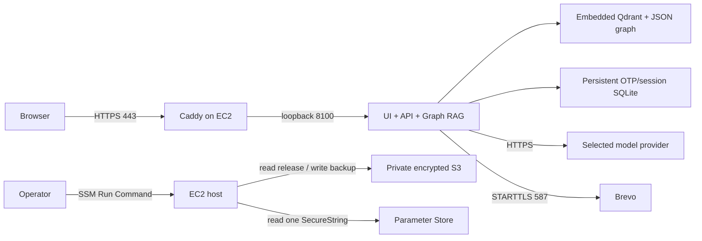

# Deploy Ask IISc on AWS

This deployment runs the current chat UI, retrieval, Graph RAG, citations, attachment downloads and email OTP service on one EC2 instance. The language model uses an external OpenAI-compatible HTTPS endpoint. The local MLX server and `config/local.json` remain unchanged. The AWS application uses `Asia/Kolkata` for term/date boundaries; the backup timer uses UTC explicitly.

The deployment is prepared for a small team demonstration. It uses one application worker and has a brief interruption during release activation. It does not provide multiple-zone availability or automatic horizontal scaling.

## Resources and boundaries



| Resource | Provisioned configuration | Purpose |
|---|---|---|
| VPC and public subnet | One availability zone, internet gateway and route | Reach the model, SMTP and AWS services without a NAT gateway |
| EC2 | AL2023 x86_64, `t3.small`, 2 GiB RAM; `t3.medium` optional | CPU embedding, retrieval, one API worker and HTTPS |
| Root disk | 16 GiB encrypted gp3 | OS and installed tools |
| Data disk | 20 GiB encrypted gp3, retained on stack deletion | Releases, indexes, environments, OTP sessions and certificates |
| Swap | 2 GiB on the encrypted data disk | Cover installation and startup memory spikes |
| Elastic IP | One public IPv4 address | Stable DNS target across stop/start |
| Security group | 80 for certificate validation/redirect; 443 for clients | No SSH, vector database or API port exposed |
| S3 | Encryption, versioning, public access blocked, TLS required | Private release bundles and daily session backups |
| IAM instance role | SSM core operations, one runtime parameter, release reads and backup writes | No access keys stored on the instance |
| Parameter Store | One Standard SecureString, created separately | Model and SMTP credentials plus runtime settings |
| Budget | Optional account-wide monthly alert at 50%, 80% and 100% | Notification; it does not stop spending |

The template creates neither an ALB, NAT gateway, RDS, managed vector database nor GPU instance. The existing embedded Qdrant and JSON graph provide the same retrieval implementation as local testing. Moving to multiple workers later requires shared admission control and a server-backed vector store.

AWS usage consumes credits when eligible; this architecture is not guaranteed to remain free. Check the account's actual plan and remaining credits before provisioning. AWS currently describes the new Free Tier as a credit-based offer with a limited free period. [AWS Free Tier FAQ](https://aws.amazon.com/free/free-tier-faqs/).

Budget APIs use USD. The default alert is USD 20, approximately ₹1,904 at an **illustrative** ₹95.20/USD; actual conversion and taxes differ. Estimate EC2 hours + 36 GiB gp3 + public IPv4 hours + S3 requests/storage in the [AWS calculator](https://calculator.aws/). Public IPv4 addresses are billed separately under [VPC pricing](https://aws.amazon.com/vpc/pricing/). A stopped instance still has storage and Elastic IP costs. Model-provider charges and limits are separate from AWS credits and AWS Budgets.

## 1. Prepare your workstation and account

Use the current application folder, rather than the older prototype on port 8080:

```bash
cd /Users/kshitij/mvps/askiisc/askiisc-retrieval
source /Users/kshitij/Desktop/askiisc/.venv/bin/activate
python -m pytest -q
```

For a fresh team checkout, create an application environment and install CPU PyTorch plus `requirements.txt` as described in the repository README. AWS release commands use Python 3.12 or newer. The EC2 host uses Python 3.12 explicitly; it does not replace AL2023's system Python. [AL2023 Python documentation](https://docs.aws.amazon.com/linux/al2023/ug/python.html).

Install AWS CLI v2 and sign in with a named deployment profile. This account uses the existing MFA-protected IAM user with short-lived AWS CLI login credentials:

```bash
aws login --profile askiisc-deploy
export AWS_PROFILE=askiisc-deploy
export AWS_REGION=ap-south-1
aws sts get-caller-identity
```

Confirm the account and use the non-root `askiisc-deploy` profile for resource creation and releases. For an IAM-user console login, AWS CLI v2 also supports `aws login --profile askiisc-deploy`; do not create root access keys. This account remains on the FREE plan and the user has authorized consuming existing credits, with no paid-plan upgrade.

One-time IAM setup uses an administrator session to create two app-only roles and one instance profile. Review the generated policies first:

```bash
python deploy/aws/iam_bootstrap.py --account YOUR_ACCOUNT_ID \
  --admin-profile YOUR_ADMIN_PROFILE --out /tmp/askiisc-iam
# Review the JSON files, then repeat with --apply.
```

The CloudFormation service role can provision the listed resources in Mumbai, use only `t3.small` and create encrypted data disks no larger than 20 GiB. It can pass only the app EC2 role and cannot create or edit IAM roles. The instance role reads one runtime parameter, reads release objects and writes session backups. The deployer can operate only this stack, write the runtime parameter and release prefix, pass the CloudFormation role, and run SSM commands on instances tagged as belonging to this stack. It has an explicit paid-plan-upgrade denial and no IAM-edit permissions. The template does not create IAM resources. The bootstrap IAM resources remain separate from the stack and must be reviewed separately during teardown. Operators with SSM command access are trusted with the host's private documents.

Set the returned execution role/profile for provisioning. For the prepared account:

```bash
ASKIISC_EXECUTION_ROLE=arn:aws:iam::800168266746:role/askiisc-prod-cloudformation
ASKIISC_INSTANCE_PROFILE=askiisc-prod-instance
```

The scoped execution role does not grant AWS Budgets permissions; leave `--budget-email` empty. An account administrator can configure an account budget separately after reviewing its cost. Budget alerts are not spending caps.

A domain is optional. Omit `--domain` to use the stable Elastic IP with trusted HTTPS. Caddy explicitly requests a Let’s Encrypt `shortlived` IP certificate and automatically renews it; no domain purchase, DNS record, Route 53 hosted zone or load balancer is needed. With your own hostname, supply `--domain` and point its A record at the IP. [Let’s Encrypt IP certificates](https://letsencrypt.org/2026/01/15/6day-and-ip-general-availability).

## 2. Test locally and package a release

Local testing keeps the current model and configuration:

```bash
./run-local.sh --port 8100
python deploy/aws/awsctl.py smoke --url http://127.0.0.1:8100
```

The smoke check uses health, readiness, identity and denied-access requests; it makes no generation call. If chat is already running, leave it running.

Create the release from the current index:

```bash
python deploy/aws/awsctl.py package --out .local/aws-releases
```

The latest prepared release is `model-20261031T054249Z-local`, available with its [deployment instructions](/Users/kshitij/Desktop/askiisc/output/aws/model-20261031T054249Z-local/README.md) and [artifact descriptor](/Users/kshitij/Desktop/askiisc/output/aws/model-20261031T054249Z-local/artifact.json). It contains snapshot `snap-9f16fd7190`, graph `rules-v4-policies`, and all 515 chunks (486 public, 10 student, 19 faculty). The older 409-chunk bundle has been retired. Package a fresh release after making any code or corpus changes.

The command prints the path to `artifact.json`. It copies the committed SQLite vector state using SQLite's backup API, verifies that the source snapshot stayed unchanged, includes the graph and classified attachments, and packages the cached BGE-small model at its exact revision. Local chat does not need to stop. Packaging fails if an attachment checksum changed or the required cached model is missing. Another machine can provide `--data-dir /path/to/index` and `--embedding-dir /path/to/model/snapshots/REVISION` explicitly.

The package excludes local model/SMTP credentials, the local profile, OTP sessions, raw crawls, evaluation outputs and virtual environments. **It does contain the student and professor source material**, so keep the bundle private. A bundle is portable across the Mac and the target Linux host; the host installs Linux CPU wheels from the hash-pinned lock file.

Set the path printed by packaging and verify it:

```bash
ASKIISC_ARTIFACT=.local/aws-releases/PRINTED_RELEASE_ID/artifact.json
python deploy/aws/awsctl.py verify "$(dirname "$ASKIISC_ARTIFACT")/bundle.tar.gz"
```

Release IDs are immutable. Keep `artifact.json`, the bundle and its two controller files together. Every file has a checksum, and S3 uploads use conditional writes to prevent an existing release key from being overwritten. [S3 conditional writes](https://docs.aws.amazon.com/AmazonS3/latest/userguide/conditional-writes.html).

## Routine releases with one command

For future application changes, use the deployment wrapper from the Desktop workspace:

```bash
cd /Users/kshitij/Desktop/askiisc
./deploy-aws.sh --build --dry-run  # package and verify locally; no AWS calls
./deploy-aws.sh                  # deploy the newest prepared artifact
```

`./deploy-aws.sh --build` packages the current application and index and deploys them in one run. Use `--artifact /absolute/path/artifact.json` to select a particular bundle. Without `--build`, selection uses the newest artifact descriptor's modification time; the selected path and release ID are printed before deployment. A corrupt newest bundle stops deployment rather than silently deploying an older one.

The portable implementation is `deploy/aws/deploy_latest.py`. From a normal project checkout, run `python deploy/aws/deploy_latest.py --build`; its default bundle directory is `.local/aws-releases`. `--bundles`, `--profile`, `--account`, `--region`, `--stack` and `--data-dir` allow explicit overrides. The Desktop wrapper selects this project's existing output directory and Python environment.

Before any AWS mutation, the script verifies the archive and controller hashes, checks the named non-root profile against account `800168266746`, requires an ACTIVE FREE plan with positive promotional credits, and checks the existing HTTPS app, model readiness and access controls. It uploads the immutable release, runs the existing candidate startup/cited-answer checks, activates it with automatic rollback on activation failure, and repeats HTTPS/access checks. It does not provision resources, change IAM, upgrade the account plan, replace runtime secrets or modify local configuration. Expired credentials, missing permissions, unavailable model tunnels or an unconfirmed account plan stop the script. Refresh login with `aws login --profile askiisc-deploy` when needed. Unset exported AWS access/session keys so they cannot override the named profile.

Model/SMTP configuration changes remain separate: update the protected runtime file and use `awsctl.py put-secret`, then create a **new** bundle/release. A final smoke failure is reported as an error; inspect status/logs and use the documented rollback command rather than retrying provisioning. The ephemeral MLX/ngrok endpoint must remain online for readiness and candidate generation. If the old tunnel is already unavailable, the routine wrapper preflight will stop. After checking the expected non-root account and FREE plan, use `awsctl.py deploy --stack askiisc-prod --region ap-south-1 --artifact NEW_ARTIFACT` for that endpoint recovery; the host validates the new captured runtime with candidate startup and cited generation before activation. Use a new release ID and run `awsctl.py smoke --url https://13.203.0.141` afterward.

## 3. Provision the AWS resources

The default region is Mumbai (`ap-south-1`). Select another region explicitly on every command if needed. Resolve and pin the OS image for both the plan and the execution:

```bash
ASKIISC_AMI_ID=$(aws ssm get-parameter \
  --name /aws/service/ami-amazon-linux-latest/al2023-ami-kernel-6.1-x86_64 \
  --query Parameter.Value --output text)

python deploy/aws/awsctl.py provision \
  --stack askiisc-prod --region ap-south-1 \
  --execution-role "$ASKIISC_EXECUTION_ROLE" --instance-profile "$ASKIISC_INSTANCE_PROFILE" \
  --ami-id "$ASKIISC_AMI_ID" --plan
```

Review the CloudFormation change set in the AWS console. It describes resources and permissions without creating the EC2 host until executed. Then run the same command without `--plan`:

```bash
python deploy/aws/awsctl.py provision \
  --stack askiisc-prod --region ap-south-1 \
  --execution-role "$ASKIISC_EXECUTION_ROLE" --instance-profile "$ASKIISC_INSTANCE_PROFILE" \
  --ami-id "$ASKIISC_AMI_ID"
```

The provisioning command waits for bootstrap success. Bootstrap mounts the encrypted data disk, installs Python and a checksum-pinned Caddy binary, creates isolated service users and systemd units, and enables SSM. CloudFormation receives a success/failure signal. It does not install an application release or contain credentials. [CloudFormation resource signaling](https://docs.aws.amazon.com/AWSCloudFormation/latest/TemplateReference/cfn-signal.html).

Record the printed `InstanceId`, `PublicIp`, `ReleaseBucket`, `DataVolumeId`, `RuntimeParameter` and `ApplicationUrl`. If bootstrap fails, inspect CloudFormation events and `/var/log/cloud-init-output.log` through Systems Manager. Infrastructure changes, such as replacing an AMI or changing the data volume, require a separate reviewed plan and backup; routine application releases do not rerun provisioning.

## 4. Verify HTTPS on the public IP

Without a domain, use the stack's `ApplicationUrl`, for example `https://PUBLIC_IP`. No DNS step is needed. Caddy explicitly uses the public ACME issuer and the required `shortlived` profile. `default_sni` selects the public-IP certificate for clients that omit SNI behind EC2 public-IP NAT. Its certificate and renewal state persist on the encrypted data disk. The certificate lasts about six days, so automatic renewal must remain operational. An issuance failure must be fixed before OTP or private-document use; never bypass the browser certificate warning.

If you supplied `--domain`, create its **A record** with the stack's `PublicIp` and remove any obsolete AAAA record. Keep port 80 public for ACME validation/redirects and port 443 available for clients. `--client-cidr` can restrict HTTPS access. [Caddy certificate configuration](https://caddyserver.com/docs/caddyfile/directives/tls).

## 5. Configure the model and OTP delivery

Use the helper to create a private configuration outside the repository, importing the existing local SMTP settings without changing them:

```bash
python deploy/aws/model_config.py --ask-key --check
python deploy/aws/model_config.py --show
```

The key prompt is hidden. The file is `~/.config/askiisc/aws-runtime.json`, created atomically with mode 0600. `--show` prints only non-secret settings. `--check` sends one short public-only model request and does not print upstream error bodies. Credentials are excluded from releases and command-line arguments.

The initial model is `xingchen-agi/xing4.0-29b-a4b:free` on `https://openrouter.ai/api/v1`, with reasoning disabled. On 30 October 2026, OpenRouter listed its Phala endpoint as zero-priced and zero-data-retention. Requests require `data_collection=deny`, `zdr=true`, and zero input/output/request price ceilings. No paid model fallback is configured. If quota or privacy-compatible availability changes, requests fail rather than silently relaxing these constraints. [OpenRouter provider controls](https://openrouter.ai/docs/guides/routing/provider-selection), [live ZDR endpoints](https://openrouter.ai/api/v1/endpoints/zdr). These controls describe provider handling; authorized RAG evidence still travels to OpenRouter and the serving provider.

To change the model or endpoint without code edits:

```bash
python deploy/aws/model_config.py --model EXACT_MODEL_ID
python deploy/aws/model_config.py --url https://provider.example/v1 --model EXACT_MODEL_ID --ask-key --check
```

Changing the endpoint clears the old API key and provider-specific options before saving, preventing an old provider credential from reaching a new provider. Switching to OpenRouter installs the free/private routing constraints. Other endpoints must use HTTPS and require their own cost/privacy review. Edit the private JSON for SMTP, token budgets or the OTP feature flag. Keep the local MLX profile in `config/local.json` unchanged.

Upload the JSON to the stack's Standard SecureString parameter:

```bash
python deploy/aws/awsctl.py put-secret \
  --stack askiisc-prod --region ap-south-1 \
  --file ~/.config/askiisc/aws-runtime.json
```

The command prints parameter version metadata, not its value. The instance reads only this parameter; values are stored in a protected per-release file. Standard SecureString uses KMS encryption. [Parameter Store encryption](https://docs.aws.amazon.com/systems-manager/latest/userguide/secure-string-parameter-kms-encryption.html).

AWS configurations default to email authentication enabled and an empty professor test override. Set `AUTH_PROFESSOR_TEST_EMAILS` in the private runtime JSON to an exact IISc address only when testing. The address still needs OTP verification. Set the value to an empty string and deploy a fresh release to remove the override. Set `EMAIL_AUTH_ENABLED` to `false` for public-only mode; this does not unlock restricted content.

### Switch AWS models from one local command

The Desktop workspace has a non-secret profile file at `/Users/kshitij/Desktop/askiisc/aws-models.json` and a wrapper at `/Users/kshitij/Desktop/askiisc/model-aws.sh`:

```bash
cd /Users/kshitij/Desktop/askiisc
./model-aws.sh local                      # deploy the saved exposed-local profile
./model-aws.sh local --url https://NEW_TUNNEL.ngrok-free.app
./model-aws.sh openrouter                  # deploy the saved OpenRouter profile
./model-aws.sh openrouter --model meta-llama/llama-3.1-8b-instruct
./model-aws.sh openrouter --check-only     # one public RAG test; leave AWS unchanged
./model-aws.sh local --dry-run             # local plan only; no network/AWS calls
```

The first OpenRouter setup accepts `OPENROUTER_API_KEY`, or use `./model-aws.sh openrouter --ask-key`. The hidden prompt saves a validated key to `~/.config/askiisc/openrouter.key` with mode 600. The JSON profile contains the key-file path and environment-variable name, never the key. `--ask-key --check-only` can validate/save the key without changing AWS. A successful deployment saves endpoint/model overrides and selects that profile, so `./model-aws.sh` repeats the last successful selection. A one-time check does not select or deploy a profile. Add `--report /private/path/result.json` to save public test outputs.

The command runs one public-only cited RAG completion against a temporary consistent copy of the local index, then verifies the named AWS identity/FREE plan, checks the existing runtime digest without exposing secrets, packages an immutable release, updates the Standard SecureString when necessary, and deploys a candidate. Old-model readiness is not a prerequisite, so an expired ngrok tunnel can be replaced. The candidate must pass readiness and public cited generation before activation. A rejected candidate restores the prior parameter; uncertain activation state is inspected before restoring anything. Protected runtime settings and the selected profile are saved after activation, and public HTTPS/access smoke checks follow. Local `config/local.json`, OTP roles, SMTP and source classifications remain unchanged.

`aws-models.json` exposes AWS account/profile/region/stack, local URL/model/template controls, and OpenRouter model/price limits. The OpenRouter profile requires `data_collection=deny`, `zdr=true`, explicit input/output price ceilings and zero per-request fees. The supplied Llama 3.1 8B profile permits up to USD 0.10 per million input and output tokens, with a USD 0.001 ceiling for a single test under the configured token limits. This is a paid model; account credits and provider quotas still apply. There is no model fallback or automatic relaxation of privacy/price controls. Selecting OpenRouter for deployment makes it the live provider until switched back; use `--check-only` for a one-time test.

The portable implementation is `deploy/aws/model_profiles.py`, with `deploy/aws/model-profiles.example.json` as its template. Use `--config`, `--root`, `--bundles` and `--data-dir` explicitly from another checkout. Refresh an expired deployer login with `aws login --profile askiisc-deploy --region ap-south-1`.

### Temporary local MLX endpoint through ngrok

Current AWS API base, verified on 31 October 2026: `https://443a-14-139-128-10.ngrok-free.app/v1`. Runtime parameter version: 3. The local profile continues to use the native loopback endpoint.

For this test deployment, the user-selected model is `mlx-community/Qwen3.5-9B-MLX-4bit` through a temporary HTTPS ngrok tunnel. Configure its API base with `/v1` and use `CHAT_TEMPLATE_KWARGS: {"enable_thinking": false}` in the private JSON. The helper supports self-hosted endpoints without an API key and sends no Authorization header when the key is empty. Changing providers clears previous credentials and provider options.

```bash
python deploy/aws/model_config.py --url https://YOUR_TUNNEL.ngrok-free.app/v1 \
  --model mlx-community/Qwen3.5-9B-MLX-4bit
# Set CHAT_TEMPLATE_KWARGS to {"enable_thinking": false} in the private JSON.
python deploy/aws/model_config.py --check
python deploy/aws/awsctl.py put-secret --stack askiisc-prod --file ~/.config/askiisc/aws-runtime.json
# Package a fresh release and deploy it to capture the new settings.
```

The AWS chat UI, retrieval index and authentication run in AWS; generation still depends on the local Mac, MLX process and tunnel. An expired tunnel stops model readiness and generation until the private runtime settings are updated and a fresh release is deployed. Keep the public AWS HTTPS URL separate from the temporary model URL. No model weights or model API keys are placed in browser code or the release archive.

## 6. Deploy and verify

Use the artifact path from step 2:

```bash
python deploy/aws/awsctl.py deploy \
  --stack askiisc-prod --region ap-south-1 \
  --artifact "$ASKIISC_ARTIFACT"

python deploy/aws/awsctl.py smoke --url https://PUBLIC_IP
python deploy/aws/awsctl.py status --stack askiisc-prod --region ap-south-1
```

The release command performs these operations in order:

1. Upload the private bundle and checksum-pinned controller files to immutable S3 keys.
2. Validate the archive and every file on the host.
3. Install or reuse a virtual environment identified by the dependency-lock hash.
4. Copy the index to a release-specific writable directory and capture the runtime parameter version.
5. Validate the original attachments, embedding model, snapshot, graph version and vector store.
6. Start a temporary candidate on loopback port 8101. Check readiness and make **one public, cited generation request** to verify the configured provider/key/quota. This can consume provider tokens. It sends no private attachment evidence.
7. Back up the session database, stop the old app, switch the release pointer and start the new app on 8100.
8. Check readiness again. A failed final check restores the previous release automatically. A failed candidate check leaves the existing release active.
9. Start HTTPS and enable daily session backups.

The local smoke command confirms that anonymous exam requests and professor attachment downloads remain denied. In the browser, verify a public question, an actual OTP login, a student-only source and a professor connected answer. Use an actual allowlisted professor or your explicitly configured test override. A student's professor request must remain denied. Check the expanded graph path and both citations for the exam question.

A successful structural health check does not establish answer quality for a new model. The candidate generation request checks completion and citation behavior; manually assess representative answers before sharing the deployment with the team.

## 7. Deploy future changes

Use the same path for code, UI, document and model-setting changes:

```bash
python -m pytest -q
python deploy/aws/awsctl.py package --out .local/aws-releases
# Set ASKIISC_ARTIFACT to the newly printed path.
python deploy/aws/awsctl.py deploy --stack askiisc-prod --artifact "$ASKIISC_ARTIFACT"
python deploy/aws/awsctl.py smoke --url https://PUBLIC_IP
```

Test changes on the local MLX setup first. A new document/graph snapshot must be built and validated in a **separate data directory**; package it with `--data-dir`. Do not rebuild an index while a process owns it. A code-only release can package the existing running index safely. Do not edit the active AWS code or ingest into its index in place.

For a credential, model or feature-flag change, update the private JSON, run `put-secret`, and create a fresh release ID with `package`. An active release retains its captured configuration until a new release is deployed. Reusing a release ID with different content/settings is rejected. The lock hash reuses an existing environment when dependencies have not changed.

For an optional AWS staging environment, use a different stack name, domain and `--parameter /askiisc/stage/runtime`. This creates additional billable resources; local testing remains available without a second AWS host.

The supplied `.github/workflows/aws-validation.yml` runs tests and CloudFormation/shell validation after this project is placed in the team's Git repository. It has no AWS credentials and does not publish private corpus data. Release operators deploy an approved bundle using the commands above. If automated deployment is added later, use GitHub OIDC to assume the scoped deployment role rather than storing access keys in GitHub.

The current model's revised programme/policy comparison remains in `output/policy-graph/2026-10-29`; it compares normal, multi-query and Graph RAG on the same corpus. See `POLICY_GRAPH.md` for graph rebuilding without re-embedding. Repeat relevant answer-quality evaluation when the model, prompt, extraction, graph rules or corpus changes. Keep private evaluation outputs out of public build artifacts.

## 8. Roll back and inspect logs

```bash
python deploy/aws/awsctl.py rollback --stack askiisc-prod
python deploy/aws/awsctl.py smoke --url https://PUBLIC_IP
python deploy/aws/awsctl.py logs --stack askiisc-prod
```

`rollback` selects the previous release, validates it on the candidate port and restores its code, corpus and captured runtime settings. It performs the same one public generation probe. Use `--release-id PREVIOUS_ID` to select a specific retained release. OTP sessions stay in the shared auth database; rollback does not overwrite them. Avoid rolling back to revoked model/SMTP credentials; use a fresh release with current credentials for that case.

Detailed logs are in systemd journals (`askiisc.service` and `caddy.service`). Journals have a 128 MiB limit and seven-day retention. A failed candidate writes `/var/lib/askiisc/candidate.log`. Open an SSM Session Manager shell from the EC2 console for `free -h`, `df -h`, `systemctl status` and `journalctl`. No SSH key or port is required. CLI `aws ssm start-session --target INSTANCE_ID` additionally needs the Session Manager plugin.

## 9. Back up, recover and control storage

A systemd timer backs up OTP/session SQLite daily to the private S3 `backups/` prefix. It uses SQLite's backup API, includes the current/previous release IDs and retains S3 backups for 30 days. Trigger one manually:

```bash
python deploy/aws/awsctl.py backup --stack askiisc-prod
```

Releases, vectors, graph and original attachments can be restored from their immutable S3 bundles. Sessions are restored separately so code rollback cannot erase active logins. The EBS data volume is retained if the stack is deleted. Before infrastructure replacement, take a manual EBS snapshot and verify that the latest session backup exists.

For loss of the host/data volume: provision a replacement stack, point DNS at its Elastic IP, recreate the runtime parameter, and deploy the approved bundle. With a recovery administrator, download the chosen private backup, inspect its members, and extract it into a temporary directory. Stop `askiisc.service`, restore only `sessions.sqlite3` into `/var/lib/askiisc/auth/`, set ownership to `askiisc:askiisc` and mode 0600, then start the service and repeat the smoke/OTP checks. The new Caddy instance can obtain a fresh certificate. Restoring a backup also restores the session revocation/OTP state at that backup time; choose a recent trusted backup.

Keep the active and previous releases plus any explicitly selected rollback targets. Inspect disk usage before removing older release directories, matching index directories and unreferenced dependency environments through SSM. The tooling does not delete rollback history automatically. S3 release objects are also retained; remove obsolete versions deliberately after deciding how much history the team needs.

To pause compute charges, stop the EC2 instance in the console. The Elastic IP and EBS volume remain billable. To remove the environment, delete the CloudFormation stack, then review the intentionally retained S3 bucket and data volume. Delete those separately only after saving needed private documents and backups. The separately created runtime parameter also remains until explicitly deleted.

## Validation record

Deployed on 30 October 2026 at **https://13.203.0.141**, on the FREE account plan using authorized credits. Active release: `model-20261031T054249Z-local`; previous: `aws-20261031-ngrok-r9`. The model is the user's local MLX Qwen3.5-9B through a temporary ngrok HTTPS tunnel. That historical release used a configured professor test exception with OTP.

The AL2023/Python 3.12 CPU dependency install, offline 515-chunk index validation, cited candidate generation, activation, subsequent app/configuration releases and private S3 backup succeeded on EC2. Live checks passed for trusted HTTPS, readiness, public cited chat, streaming connected answer with two graph proofs, guest private-access denials, IISc-only email validation, hidden diagnostics, redirects and SMTP TLS/authentication. A real mailbox OTP verification was not performed in this deployment run.

The public-IP no-SNI setting was applied to the live Caddyfile after certificate issuance and is included in the bootstrap for future hosts. Existing stack first-boot UserData predates that small host-config patch. Review planned infrastructure changes separately; ordinary app updates use S3/SSM and do not rerun provisioning. See the release `deployment-status.json` and `output/aws/preflight` for executed checks, account state and failure cleanup records. Local MLX configuration remains unchanged and local chat was verified working.
